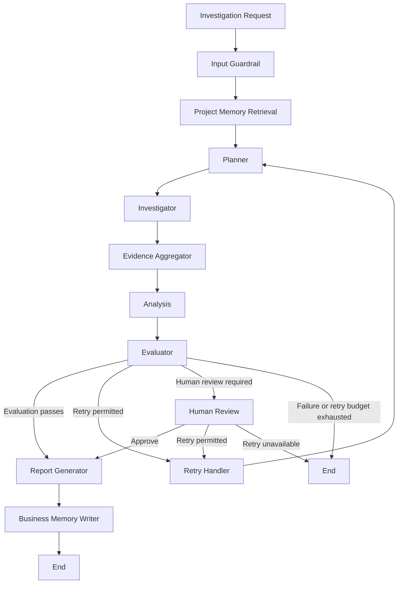

# Enterprise AI Operations Platform

An agentic AI platform for investigating enterprise delivery risks across Jira and GitHub using **LangGraph, MCP, Gemini, Groq, and LangSmith**. It coordinates evidence collection, evaluates investigation results, supports bounded retries and human review, and maintains project-level business memory.

## The Problem

Enterprise delivery information is distributed across operational systems. When a project is delayed or a deployment is at risk, engineers often need to correlate Jira tasks, sprint status, GitHub issues, commits, and deployment information manually.

This creates several challenges:

- **Fragmented evidence:** Relevant information is spread across multiple systems.
- **Manual investigation:** Engineers repeatedly switch between tools to connect findings.
- **Insufficient evidence:** An investigation may not retrieve enough information to support a conclusion.
- **Unreliable answers:** An LLM can produce convincing conclusions without adequate supporting evidence.
- **Limited recovery:** Failed tools and incomplete investigations need controlled recovery mechanisms.
- **Repeated context gathering:** Previous project findings should inform subsequent investigations.

A conventional chatbot is not enough. The system needs to coordinate tools, track investigation state, evaluate evidence, recover from failures, and involve humans when appropriate.

## The Solution

The platform treats an operational question as a **stateful, multi-step investigation workflow**, rather than a single LLM call.

For a request such as *"Investigate the current status of this project and identify potential delivery risks,"* the system:

1. Validates the request and retrieves relevant project memory.
2. Plans the investigation and identifies required evidence sources.
3. Collects evidence from Jira and GitHub through MCP-integrated tools.
4. Aggregates evidence and records failures.
5. Analyzes findings and evaluates evidence sufficiency.
6. Generates a report, retries with a revised plan, requests human review, or terminates according to workflow rules.
7. Persists eligible findings for future investigations.

LangGraph orchestrates the workflow. Gemini and Groq handle different LLM responsibilities, while LangSmith supports LLM/workflow observability and evaluation. FastAPI exposes the backend, Streamlit provides the interface, and Docker Compose coordinates the application and MCP services.

## Investigation Lifecycle



When a retry is permitted, execution returns to the planner. The next plan can use previous failure information and missing evidence to guide another investigation attempt.

### Workflow Components

| Component | Responsibility |
|---|---|
| Input guardrail | Validates the investigation request. |
| Memory retrieval | Retrieves active project-associated findings. |
| Planner | Creates a structured investigation plan. |
| Investigator | Executes tools and records investigation history. |
| Aggregator and analysis | Consolidate evidence and interpret findings. |
| Evaluator and router | Assess results and select the next workflow path. |
| Retry handler | Updates retry state and returns execution to planning. |
| Human review | Pauses execution for a human decision and supports resumption. |
| Report generator | Generates a report and validates its output. |
| Business memory writer | Persists eligible findings for future investigations. |

## Key Engineering Capabilities

### 1. Agentic Workflow Orchestration

LangGraph coordinates planning, investigation, aggregation, analysis, evaluation, and reporting through shared state and conditional transitions. This separates workflow responsibilities and makes execution behavior easier to inspect and test.

### 2. Jira and GitHub Integration Through MCP

The platform integrates operational tools through the Model Context Protocol (MCP).

**Jira**
- Retrieve open tasks.
- Retrieve blocked tasks.
- Retrieve overdue tasks.
- Retrieve the current sprint.

**GitHub**
- Retrieve repository issues.
- Retrieve recent commits.
- Retrieve deployment status.

Tool execution validates registered tool names and required arguments. Failures are recorded rather than automatically treated as successful evidence collection.

### 3. Bounded Retries and Evidence-Aware Replanning

The platform distinguishes two recovery mechanisms:

- **Agent-level investigation iterations:** Bound the sequence of LLM and tool interactions within an individual investigation.
- **Workflow-level retries:** Allow another planning and investigation cycle when evaluation indicates insufficient evidence and the retry budget permits it.

The retry handler preserves relevant context, while the planner can focus the next attempt on missing information. Retry budgets prevent unbounded workflow loops.

### 4. Human-in-the-Loop Control

The human-review node uses LangGraph interruption and resumption to pause execution when a human decision is required.

The current API supports:

- `approve` — continue toward report generation.
- `retry` — initiate another investigation attempt if the retry budget permits it.

The workflow can terminate when retries are exhausted.

### 5. Guardrails and Structured Failure Handling

Application-level safeguards include:

- Input validation and query-length limits.
- Tool availability and argument validation.
- Structured classification of tool and workflow failures.
- Output validation for generated reports.

These mechanisms improve control over workflow execution but do not guarantee recovery from every LLM, external-service, or infrastructure failure.

### Failure Modes and Recovery

The following table documents behavior verified in the application code. It does not imply that every failure has an automatic recovery path.

| Failure mode | Detection | Current behavior | Recovery or coverage |
|---|---|---|---|
| Gemini rate limit (`429`) | Gemini API exception handled by FastAPI | Returns HTTP `429` with a quota/rate-limit message. | Client can retry when quota or rate-limit conditions permit. |
| Gemini temporarily unavailable (`503`) | Gemini API exception handled by FastAPI | Returns HTTP `503` with a temporary-unavailability message. | Client can retry later. |
| Other Gemini API error | Gemini API exception handler | Returns HTTP `502` and exposes the provider status when available. | Backend logs the exception; investigate the provider failure. |
| Unexpected workflow exception | General exception handler in the investigation endpoint | Returns HTTP `500` with an error reference and logs the exception. | Use backend logs to diagnose the failure. |
| Tool execution failure | Investigation/tool failure handling | Failure information is recorded in the workflow rather than automatically counted as successful evidence. | Workflow retry/replanning depends on evaluation, routing, and the remaining retry budget. |
| Insufficient investigation evidence | Application evaluator and router | Routes to retry when required and permitted, otherwise follows the configured failure or review path. | The retry handler returns control to the planner when a retry is allowed. |
| Invalid generated report | Output guardrail in the report-generation node | Clears the report, sets `output_guardrail_failed`, and records the validation error. | The node does not itself retry report generation. |
| Human-review interruption | LangGraph interrupt state detected by the API | Returns `awaiting_human_review` and includes review context. | Resume through the API with a supported decision. |

**Test coverage:** The latest full local test run passed 86 tests. The exact mapping between individual failure modes and specific tests has not been audited for this README; consult the test suite before claiming that every row has a dedicated test.

### 6. Project-Level Business Memory

The platform uses SQLAlchemy and SQLite to maintain project-associated findings. The memory layer supports retrieval of active findings, persistence of eligible findings, duplicate avoidance, updates or invalidation, and confidence-based storage rules.

Two mechanisms serve different purposes:

| Mechanism | Implementation | Purpose |
|---|---|---|
| Workflow checkpointing | LangGraph `MemorySaver` | In-memory checkpoints for workflow interruption and resumption. |
| Business memory | SQLAlchemy and SQLite | Persistent project findings for future investigations. |

`MemorySaver` checkpoints are not durable across application restarts. SQLite business memory is a separate persistence layer.

### 7. LLM Responsibilities and Observability

The application uses two LLM providers for different responsibilities:

- **Google Gemini:** Used for planning and investigation-related LLM operations.
- **Groq:** Used for analysis, evaluation, and report generation, including the `openai/gpt-oss-120b` model in the report-generation agent.

This is a separation of responsibilities in the current implementation, not a claimed automatic fallback between providers.

LangSmith is integrated for LLM/workflow observability and evaluation. The application's evaluator assesses investigation results and influences workflow routing; LangSmith provides complementary tracing and evaluation capabilities.

OpenTelemetry instrumentation is planned, not yet implemented.

## Engineering Highlights

- Designed a stateful, multi-stage investigation workflow with LangGraph.
- Integrated Jira and GitHub through MCP-based tool interfaces.
- Implemented bounded tool iterations and workflow-level retry/replanning as distinct mechanisms.
- Built evidence-aware evaluation and conditional workflow routing.
- Implemented human-review interruption and resumption.
- Added structured failure handling and investigation-history tracking.
- Implemented project-level business memory using SQLAlchemy and SQLite.
- Integrated LangSmith for LLM/workflow observability and evaluation.
- Exposed investigation workflows through FastAPI and Streamlit, with Docker Compose orchestration.
- Built automated tests covering workflow components, integrations, and recovery scenarios.

## Technology Stack

| Layer | Technologies |
|---|---|
| Language | Python 3.11+ |
| Workflow orchestration | LangGraph |
| LLM providers | Google Gemini, Groq |
| Observability and evaluation | LangSmith |
| Tool interoperability | Model Context Protocol (MCP) |
| Backend / frontend | FastAPI, Uvicorn, Streamlit |
| Validation and configuration | Pydantic, pydantic-settings |
| Business memory | SQLAlchemy, SQLite |
| Containerization | Docker, Docker Compose |
| Dependency management | uv |
| Testing | pytest, pytest-asyncio |
| Deployment | AWS EC2, Docker containers |

## Project Structure

```text
enterprise-ai-operations-platform/
├── app/
│   ├── agents/          # Investigation, analysis, evaluation, reporting
│   ├── api/             # FastAPI application and endpoints
│   ├── config/          # Application configuration
│   ├── errors/          # Structured failure handling
│   ├── guardrails/      # Input, tool, and output validation
│   ├── llm/             # LLM client implementations
│   ├── mcp/             # Jira and GitHub MCP clients/servers
│   ├── memory/          # Business-memory models and services
│   ├── observability/   # Logging and observability-related code
│   ├── state/           # Shared investigation state
│   ├── storage/         # Database initialization
│   ├── tools/           # Jira and GitHub integrations
│   └── workflow/        # Graph, planning, routing, retries, review
├── frontend/            # Streamlit interface
├── scripts/             # Development and diagnostic scripts
├── tests/               # Automated tests
├── compose.yaml         # Application and MCP services
├── Dockerfile.backend
├── pyproject.toml
├── uv.lock
└── README.md
```

## Running the Project Locally

### Prerequisites

- Python 3.11 or later and [uv](https://docs.astral.sh/uv/).
- Docker Desktop with Docker Compose.
- Jira access and an API token.
- A GitHub token with repository access.
- Gemini and Groq API credentials.
- LangSmith configuration for the integrated observability and evaluation setup.

### 1. Clone the repository

```bash
git clone https://github.com/ramamoorthi-m/enterprise-ai-operations-platform.git
cd enterprise-ai-operations-platform
```

### 2. Configure environment variables

Create a `.env` file in the repository root:

```dotenv
APP_NAME=Enterprise AI Operations Platform
ENVIRONMENT=development
LOG_LEVEL=INFO

JIRA_URL=
JIRA_EMAIL=
JIRA_API_TOKEN=
JIRA_PROJECT_KEY=

GITHUB_TOKEN=
GITHUB_OWNER=
GITHUB_REPO=

GEMINI_API_KEY=
GEMINI_MODEL=

GROQ_API_KEY=
```

Supply valid credentials and configuration values. Configure any additional LangSmith environment variables required by your setup.

**Security:** Never commit `.env` files, API keys, or access tokens to Git.

### 3. Start the application

```bash
docker compose up --build
```

The Compose configuration defines four services:

| Service | Purpose |
|---|---|
| `api` | FastAPI backend |
| `frontend` | Streamlit interface |
| `jira-mcp` | Jira MCP server |
| `github-mcp` | GitHub MCP server |

When the services start successfully, the configured local endpoints are:

| Resource | Local address |
|---|---|
| Streamlit | `http://localhost:8502` |
| FastAPI | `http://localhost:8000` |
| Swagger documentation | `http://localhost:8000/docs` |
| Health check | `http://localhost:8000/health` |

Stop the services with:

```bash
docker compose down
```

## Quick-Start Example

You can submit an investigation through the Streamlit interface or call the FastAPI endpoint directly.

### 1. Submit an investigation

```bash
curl -X POST "http://localhost:8000/api/v1/investigate" \
  -H "Content-Type: application/json" \
  -d '{
    "query": "Investigate the current status of my project and identify delivery risks.",
    "project": "SCRUM"
  }'
```

The `project` field is optional. If omitted, the configured Jira project key is used.

### 2. Understand the response

The following is an **illustrative response shape**, not a captured execution result. Field names and types match the `InvestigationResponse` model. Values and nested collection contents are examples.

```json
{
  "thread_id": "<generated-thread-id>",
  "status": "report_generated",
  "evaluation_passed": true,
  "confidence": 0.85,
  "human_review_required": false,
  "human_review_reason": "",
  "review_payload": {},
  "plan": [],
  "investigation_history": [],
  "analysis": {},
  "final_report": "# Enterprise Project Investigation Report\n\n## Investigation Request\n[Original investigation request]\n\n## Executive Summary\n[Summary based on collected evidence]\n\n## Key Findings\n[Evidence-supported findings]\n\n## Risks\n[Identified risks or uncertainty]\n\n## Evidence Gaps\n[Missing or incomplete evidence]\n\n## Confidence\n[Assessment of confidence]",
  "errors": []
}
```

The report sections follow the structure requested by the report-generation agent. This example does not represent actual Jira/GitHub findings or a verified successful end-to-end run.

Possible outcomes include:

- `report_generated` — the report-generation agent returned a report and the output guardrail accepted it.
- `awaiting_human_review` — the API detected a LangGraph interruption requiring human review.
- `output_guardrail_failed` — report validation failed; the report is cleared and an error is recorded.

Other statuses depend on the workflow nodes and their state updates. The response also includes evaluation, confidence, plan, investigation history, analysis, review details, and errors.

## API Reference

### Health check

```http
GET /health
```

### Start an investigation

```http
POST /api/v1/investigate
Content-Type: application/json
```

Example request:

```json
{
  "query": "Investigate the current status of my project and identify delivery risks.",
  "project": "SCRUM"
}
```

The input guardrail requires a query between 10 and 2,000 characters. The Pydantic request model itself permits 3–2,000 characters, so queries shorter than 10 characters can pass model validation but fail the input guardrail.

### Resume a human-reviewed investigation

```http
POST /api/v1/investigate/resume
Content-Type: application/json
```

Example request:

```json
{
  "thread_id": "THREAD_ID_FROM_THE_PREVIOUS_RESPONSE",
  "decision": "approve"
}
```

The supported decisions are `approve` and `retry`. The thread ID must identify a workflow paused for human review.

Use `http://localhost:8000/docs` to inspect the running API's request and response schemas.

## Testing

The project includes automated tests for workflow components, tool integrations, guardrails, business memory, evaluation, API behavior, and retry-related scenarios.

**Latest verified local result: 86 passed, 2 warnings in 4.62 seconds.**

Run the test suite with:

```bash
uv sync --dev
uv run pytest -q
```

Run the workflow retry test independently:

```bash
uv run pytest tests/test_workflow_retry.py -q
```

The two warnings in the latest run concern the deprecated FastAPI `@app.on_event("startup")` lifecycle pattern. The test run passed, but the warnings remain to be addressed.

GitHub Actions CI has not yet been implemented. The reported test result is from the local environment.

## Deployment

The application has been deployed to **AWS EC2 using Docker containers**. The EC2 instance is currently stopped when the demo is not in use to control costs, so a continuously available public demo is not provided.

A public IPv4 address alone does not guarantee external reachability. AWS network rules, running containers, application health, and the current instance address must be verified before accessing the deployment.

Screenshots, a demo video, and a verified public demo link can be added once they are available.

## Known Limitations

- LangGraph workflow checkpoints use `MemorySaver` and are not durable across process restarts.
- SQLite business memory is implemented, but production-scale concurrent workloads have not been validated.
- External-service and LLM failures can affect investigation completeness and report quality.
- Production-level security, reliability, monitoring, and recovery require further validation.
- GitHub Actions CI/CD, OpenTelemetry instrumentation, and Terraform infrastructure provisioning are not yet implemented.
- A continuously available public demo is not currently provided.

## Engineering Roadmap

| Area | Planned improvement | Intended outcome |
|---|---|---|
| CI | GitHub Actions | Run tests and build validation on pushes and pull requests. |
| Observability | OpenTelemetry | Standardize application traces, metrics, and instrumentation. |
| Infrastructure as Code | Terraform | Make AWS infrastructure reproducible and version-controlled. |
| Workflow reliability | Additional retry/replanning tests | Verify recovery, evidence preservation, and retry-budget enforcement. |
| Human review | Interruption and resumption tests | Validate approval, retry, and exhausted-retry paths. |
| Operational resilience | Deployment and recovery validation | Improve health checks and repeatable deployment procedures. |

LangSmith will continue to support LLM/workflow observability and evaluation, while OpenTelemetry is intended to complement it with standardized application-level instrumentation.

## License

No license has been specified in this repository. Until a license is added, do not assume that the code is licensed for reuse or redistribution.